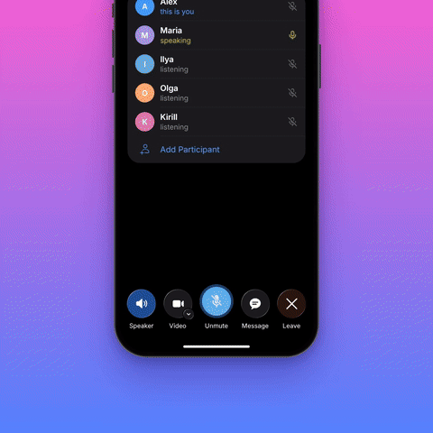
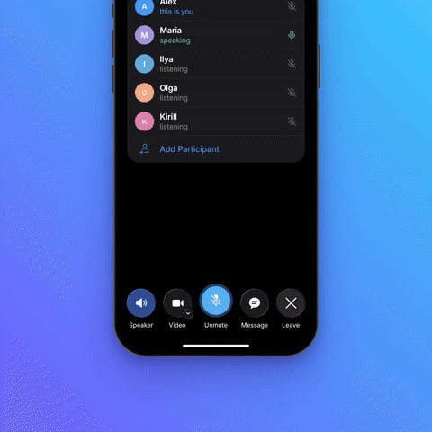

# Stream quality & camera effects for Telegram video chats

Telegram already lets anyone go live, stream from OBS and earn Stars. But in a video chat you still can't choose how your stream looks: screen sharing has no resolution or frame-rate setting, and the camera has no background or lighting options.

This concept adds both, inside the existing call UI and without new call logic. It is a patch for [Telegram-iOS](https://github.com/TelegramMessenger/Telegram-iOS), written in the client's own code and components.

One entry point opens both features: the Video button gets a small chevron, and a tap shows **Turn On Camera** or **Share Screen**. Screen sharing no longer hides in the ⋯ menu.

## Camera settings

<p align="center"></p>

**Turn On Camera** opens a sheet with a live preview, so you see the result before anyone else does:

- **Background**: None, Blur, Studio, or Custom (your own photo, Telegram Premium);
- **Appearance**: Lighting brightens a dim room, Touch Up softens the skin;
- **Turn On Video** starts the camera with these effects. Switching between front and back cameras keeps them.

Effects run on the device. Vision person segmentation (only while a background effect is on) → Core Image (lighting, touch up, background blend) → a custom `OngoingCallVideoCapturer` — the same external-buffer path that screen sharing uses. The call engine and the server see an ordinary video stream, so every participant, on any client, sees the result.

## Share Screen with quality settings

<p align="center"></p>

**Share Screen** opens a sheet before the system broadcast picker:

| Setting | Options | Telegram Premium |
| --- | --- | --- |
| Resolution | 720p, 1080p, 1440p | 1440p |
| Frame Rate | 15, 30, 60 FPS | 60 FPS |
| Device Audio | on / off | — |

1080p and 30 FPS are the default and match what screen sharing sends today. Lower settings keep a stream smooth on a weak network; 15 FPS is enough for slides and code.

The settings are applied **inside the broadcast upload extension**, to every ReplayKit frame:

- **Resolution** caps the short side of the frame (a portrait iPhone screen is 1179 px wide, so 1080p sends 1080 px). Frames are scaled with one `VTPixelTransferSession` and a small buffer pool, to stay within the extension's 50 MB memory limit. A frame is never upscaled.
- **Frame rate** is a presentation-time gate: a still screen costs nothing, a busy one is capped.
- **Device Audio** off drops the app-audio buffers.

The app and the extension already share the app-group container, so the settings travel as a small JSON file next to the existing `broadcast-coordination` files. No server or call-engine changes.

## Why it's worth it for Telegram

- **Premium gets a perk that viewers see.** 1440p, 60 FPS and custom backgrounds show up in every stream, so each broadcast advertises Premium. Discord sells stream quality the same way with Nitro.
- **More streaming means more Stars.** Better picture keeps creators streaming in Telegram, where Live Stories already earn Stars from donations and paid comments.
- **More people turn the camera on.** Blur and lighting remove the main reasons to keep video off in classes, meetings and communities.

## Repository layout

```
changes.patch      the whole change as one diff against Telegram-iOS (apply it, see below)
sources/           every changed file in full, at its path in Telegram-iOS
ci/                GitHub Actions workflow that builds the app and runs the tests
media/             demo animations (GIF for this page, MP4 in full quality)
```

The same changes live as commits on the [`concept/stream-quality`](https://github.com/adentxxx/Telegram-iOS/tree/concept/stream-quality) branch of my Telegram-iOS fork, where the CI runs.

## Source files

New files are marked **new**; the rest are upstream files with the changes applied (the exact edits are in `changes.patch`).


| File | What |
| --- | --- |
| [`submodules/TelegramVoip/Sources/ScreencastQualitySettings.swift`](sources/submodules/TelegramVoip/Sources/ScreencastQualitySettings.swift) | **new** · Settings model and storage, target-size math, frame-rate gate, frame processor |
| [`Telegram/BroadcastUpload/BroadcastUploadExtension.swift`](sources/Telegram/BroadcastUpload/BroadcastUploadExtension.swift) | Applies the settings to video and audio buffers |
| [`submodules/TelegramCallsUI/Sources/VideoChatScreen.swift`](sources/submodules/TelegramCallsUI/Sources/VideoChatScreen.swift) | Video button menu and chevron badge, opening the sheets |
| [`submodules/TelegramCallsUI/Sources/VideoChatCameraSettingsScreen.swift`](sources/submodules/TelegramCallsUI/Sources/VideoChatCameraSettingsScreen.swift) | **new** · Camera sheet: preview, background options, appearance chips |
| [`submodules/TelegramCallsUI/Sources/VideoChatCameraEffectsCapturer.swift`](sources/submodules/TelegramCallsUI/Sources/VideoChatCameraEffectsCapturer.swift) | **new** · Capture session and effects pipeline that feeds the call |
| [`submodules/TelegramCallsUI/Sources/VideoChatShareScreenSettingsScreen.swift`](sources/submodules/TelegramCallsUI/Sources/VideoChatShareScreenSettingsScreen.swift) | **new** · Share Screen sheet: list rows, context menus, Premium gating |
| [`submodules/TelegramCallsUI/Tests/VideoChatStreamQualityTests.swift`](sources/submodules/TelegramCallsUI/Tests/VideoChatStreamQualityTests.swift) | **new** · Unit tests for the quality and Premium rules |
| [`submodules/TelegramCallsUI/BUILD`](sources/submodules/TelegramCallsUI/BUILD) | Component dependencies, test dependency |
| [`Telegram/Telegram-iOS/en.lproj/Localizable.strings`](sources/Telegram/Telegram-iOS/en.lproj/Localizable.strings) | New strings |

The sheets are built only from components the app already uses — `ResizableSheetComponent`, `ListSectionComponent`, `ListActionItemComponent`, `GlassBarButtonComponent`, `ButtonComponent`, `ContextController` — so they follow the current Liquid Glass design and the dark call theme.

## Apply the patch

The patch is made against Telegram-iOS `master` at commit `24638bc69b`.

```
git clone --recursive https://github.com/TelegramMessenger/Telegram-iOS.git
cd Telegram-iOS
git checkout 24638bc69bd083981b178dd1e7f921eebbf7fc46
git apply --check /path/to/changes.patch
git apply /path/to/changes.patch
```

Then build as described in the Telegram-iOS README. To run the unit tests:

```
python3 build-system/Make/Make.py --cacheDir="$HOME/telegram-bazel-cache" test \
    --target //submodules/TelegramCallsUI:TelegramCallsUITests \
    --configurationPath build-system/appstore-configuration.json \
    --codesigningInformationPath build-system/fake-codesigning
```

To build in your own fork without a Mac, copy `ci/concept-stream-quality.yml` to `.github/workflows/` and `ci/pick_simulator.py` to `.github/concept/`. The workflow runs on GitHub's `xcode-27` runner, runs the unit tests and uploads a Simulator build of the app.

## Notes

- Tested by hand in the iOS Simulator: video source menu, Camera sheet with live effects, Share Screen sheet with Premium locks.
- Verified on GitHub's `xcode-27` runner (Xcode 27.1): the full Telegram app builds for the iOS Simulator with the project's `-warnings-as-errors`, including the broadcast upload extension, and `TelegramCallsUITests` pass ([CI run](https://github.com/adentxxx/Telegram-iOS/actions/runs/44741001012)).

- The iOS Simulator has no camera and no ReplayKit broadcasts. There the camera sheet applies the effects to the selfie placeholder the app already uses for simulated video; screen sharing needs a real device.
- Premium values are clamped when the settings load, so an account that loses Premium can't keep 1440p or 60 FPS.
- Full-quality videos: [camera-settings.mp4](media/camera-settings.mp4), [share-screen.mp4](media/share-screen.mp4).

*Unofficial concept, not affiliated with Telegram.*
